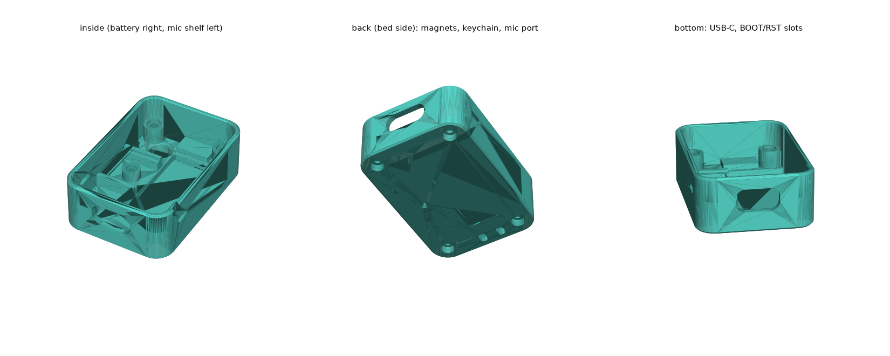
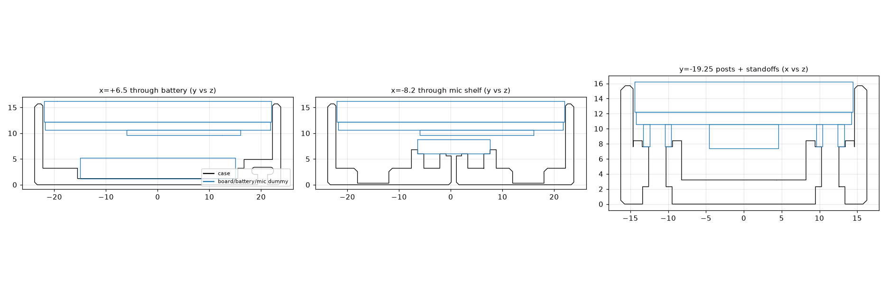
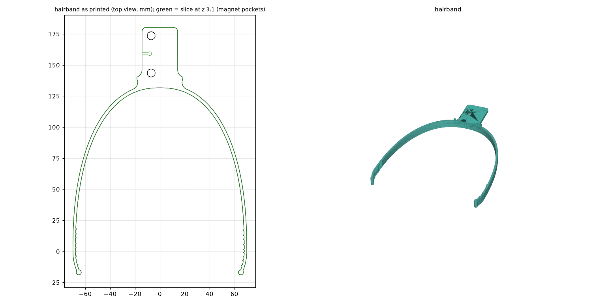
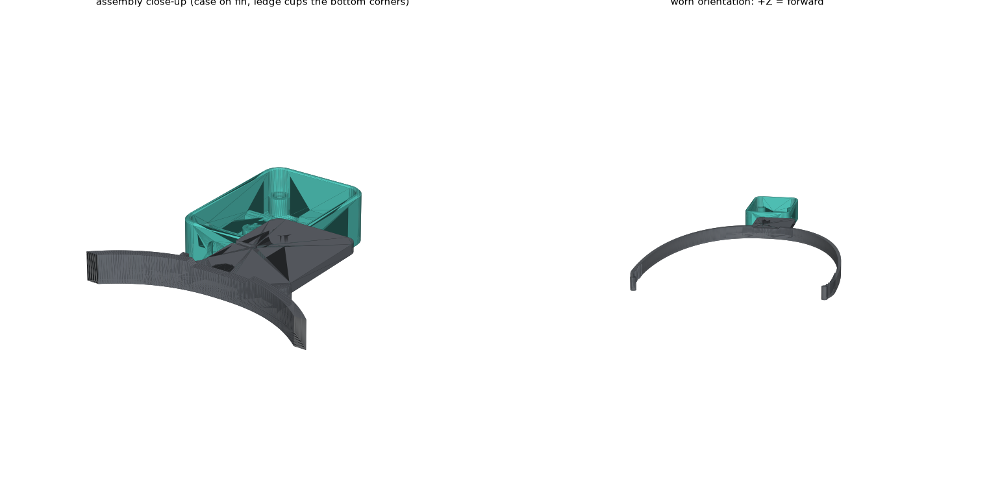

# Doobie Companion: case + hairband (CAD rev B)

Two printed parts, both parametric CadQuery:

- **`case.py` (back case):** the Waveshare ESP32-S3-Touch-AMOLED-1.64 screws into it. It holds an EEMB LP401730 LiPo and an Adafruit PDM mic, and has two SOLDR-spec magnets plus a keychain bar on the back.
- **`hairband.py` (magnetic hairband):** a fin on top carries the matching magnets. Doobie snaps on upright, display facing forward, like a little face on top of your head.






## Files
| File | What |
|---|---|
| `case.py`, `hairband.py` | Sources. All dimensions are at the top. `hairband.py` imports the magnet and outline geometry from `case.py`, so the two always match. |
| `case.step/.stl/.3mf` | Back case. |
| `hairband.step/.stl/.3mf` | Hairband. |
| `board_dummy.step`, `_board_dummy.stl` | Simplified board for the checks: glass, PCB, standoffs, JST, USB-C, flat parts, battery, mic. |
| `_assembly_case.stl` | Case placed on the hairband fin, used for the assembly check and render. |
| `render.py` | Previews and wall-thickness check. Needs trimesh + matplotlib. |

To rebuild, use `~/snrgy-ereader-cad/.venv/bin/python` (CadQuery 2.8):
```
case.py        # prints dims, screw length, interference vs board dummy
hairband.py    # prints band dims + assembly check (case on fin)
python render.py
```
Current results: **0 mm³ interference** between the case and every board part, battery and mic, and **0 mm³** between the case and the hairband when mated. Both meshes are watertight.

---

## Material

**Pick: Bambu PETG, translucent, on the P1S, for both the case and the hairband.**

| Material | HDT @0.45 MPa (typ.) | Case | Hairband | Notes |
|---|---|---|---|---|
| PLA | ~55–57 °C | ✗ | ✗ | Softens in a hot car or strong sun, creeps with body heat, and the keychain bar snaps. |
| **PETG** | **~69–70 °C** | **✓** | **✓** | Tough, flexes before it breaks, resists sweat and skin oils, and comes translucent. Easy on the P1S. Don't leave it on a car dashboard (70–90 °C). |
| PETG-CF | ~74 °C | ✓ | ✗ | Stiffer and matte, but opaque. Brittle when the band flexes. Abrasive, so it needs a hardened nozzle (the P1S ships with stainless steel). |
| ASA | ~95–100 °C | ✓ | ~ | Best for heat and UV. The P1S enclosure handles it, but it's opaque, has fumes, and is stiffer and less forgiving in a band. Upgrade path if heat becomes a problem. |
| ABS | ~85–90 °C | ✓ | ~ | Same as SOLDR's production parts. Warps, has fumes, yellows in UV. ASA is the better version. |
| TPU 95A | — | ✗ | ✗ | Too floppy for either part. Could be a bumper or a non-slip liner on the band's inner face. |
| PA / PA-CF | ~80–150 °C | ✓ | ✓✓ | The springiest band material, but it must be dried, and the CF grade needs a hardened nozzle. Consider it for a v2 band. |

Why PETG: body heat (37 °C) and sweat are fine, and it survives a pocket or bag in summer. The band flexes open about 15 mm every time you put it on, which PETG handles and PLA and CF grades don't. It prints cleanly on the P1S. Translucent PETG also shows off the internals, which is why the inside layout is kept tidy (see Layout).

### PETG print settings (Bambu Studio, P1S)
- **Profile:** "Bambu PETG Translucent" or the HF profile. Nozzle 245–255 °C, bed 70 °C.
- **Plate:** textured PEI. Add a thin glue-stick layer as a release agent; PETG can bond too strongly and tear the PEI.
- **Cooling:** fan off for the first 3 layers, then 30–50%. Closed door is fine. If the chamber goes above about 40 °C, open the top lid to avoid heat creep.
- **Layers:** 0.2 mm, first layer 0.2.
- **Walls:** **4** (1.6 mm, so the case walls print fully solid: strongest and clearest).
- **Infill:** 100% rectilinear for the case (it's small, gives maximum clarity and strength, and the keychain and magnet floor stay solid). 40% gyroid is fine for the hairband fin.
- **Supports:** **none** on either part.
- **Outer wall speed:** about 60 mm/s for a glossy translucent look. Turn ironing off.
- **Magnet skins (0.3 mm):** at 0.2 mm layers the slicer rounds the skin to 1–2 layers. For a clean, predictable skin, either set the first layer to 0.3 mm (case: the skin is exactly 1 layer) or change `MAG_SKIN = 0.4` in `case.py`, which applies to both parts. Pull drops only slightly.

---

## Case: layout
```
 front view (display side)          back face (bed side, mirrored)
 ┌───────────────────────────┐
 │ o    [key bar]          o │   o  posts → brass standoffs (4 corners)
 │  (M)                      │   M  magnets  x=-7, y=±15   (SOLDR 30 mm pitch)
 │ ┌mic┐ ┌─────────────────┐ │      mic breakout on rails + acoustic chimney,
 │ │ ◦ │ │  LP401730        │ │      port Ø1.0 through the back
 │ └───┘ │  (lengthwise)    │ │      battery lengthwise, pocket into the right wall
 │  (M)  └─────────────────┘ │
 │ o        [USB-C]        o │   BOOT slot left wall, RST slot right wall
 └───────────────────────────┘
```
- **Outer size:** **32.72 × 47.60 × 15.70 mm**. The glass stands 0.5 proud, so the total is **16.2 mm**. Corners R5.5, chamfers 0.6 on top and 0.5 on the back.
- **Walls:** side walls 1.6 mm, 1.2 mm where the battery recesses into the right wall. Back plate 3.2 mm, battery floor 1.2 mm.
- **Stack from the bed:**
  - battery pocket: z 1.2 → 5.8
  - mic shelf: z 6.0
  - post tops (standoff ends): z 7.6
  - PCB back: z 10.6
  - glass front: z 16.2

### Layout trade-off (LP401730)
The 30 mm cell can't lie across the 29.5 mm inner width with room for its leads, so it runs **lengthwise on the right**, between the right-hand standoffs. That pushes the magnets into a **left column at x = −7**. It's the only x where a 30 mm pitch clears the posts and the counterbores.

Lengthwise, the battery always sits under the BAT socket and plug. The case therefore stacks the battery (recessed into the floor) below that roughly 3.5 mm part. That costs **+0.7 mm over rev A**.

The mic breakout (12.8 mm wide) doesn't fit beside the battery on the floor; it would need 0.6 mm more width. It rides on a shelf just above the battery edge instead, which costs **another +1.0 mm**.

Thickness at the rim, excluding glass:

| Variant | Rim | Note |
|---|---|---|
| rev A (402025 across) | 14.0 | Superseded. |
| **rev B, mic** (`MIC_POCKET = True`, default) | **15.7** | |
| rev B, no mic (`MIC_POCKET = False`) | 14.7 | Same layout, the mic shelf disappears. Screws become M2×7. |

The thinnest option that keeps a 150 mAh cell would be **a 1–2 mm longer case** with the battery parked clear of the socket. I didn't take it because it changes the look (a chin or brow below the glass).

### Mounting: brass standoffs
The four brass M2 hex standoffs stand about 3.0 mm off the PCB back. The posts land on the standoff ends at z 7.6, and each hex drops into a 0.8 mm locator rim (Ø4.0).
- **Screws:** **4 × M2 × 8 ISO 7380 button head** (Ø3.5 head in Ø3.9 × 2.3 counterbores). They engage **2.7 mm** in the standoffs, staying under 3 mm so they never bottom out. Without the mic: M2 × 7.

### Battery: EEMB LP401730 (4.0 × 17 × 30, 150 mAh)
- **Pocket:** **17.6 × 31.0 × 4.6 mm** (0.3 / 0.5 clearance plus 0.6 swelling margin), recessed 2.0 mm into the floor.
- **Leads:** put the lead end toward the USB-C. The 40 mm leads run over the battery to the JST 1.25 **BAT** socket, and there's a 4.8 mm gap above the cell to coil the slack. Don't pinch the leads under the mic rails.
- **Retention:** the PCB holds the cell in place. A square of Kapton or foam tape on top stops rattle.

### Mic: Adafruit PDM breakout #3492 (14.0 × 12.8 × 2.8, port on the bottom)
- **Position:** it sits on two rails at z 6.0 over the left strip, between the magnets, with its port over an **acoustic chimney**. The chimney has a Ø3 × 0.4 gasket recess on top and a **Ø1.0 hole** (with a small outer countersink) through the back at (−8.2, +0.6).
- **Retention:** low lips at the rail ends stop it sliding. Use a Ø3 adhesive foam gasket ring (or a dab of hot glue on a corner) to seal the port and hold the board.
- **Port location:** taken as the board centre (`MIC_PORT`). Measure yours and set the offset if it's elsewhere.

### Keychain
- **Slot:** a flush 8 × 3 mm slot at the top of the back (x = +2.5).
- **Bar:** **3.5 × 2.0 mm, spanning 4.2 mm**. The roots have fillets in plan (R0.8) and on the channel ends (R0.6).
- **Channel:** 1.4 mm high, with a **1.5 mm ceiling** from a boss inside.
- **Strength:** at a 50 N tug the bar sees about 11 MPa, roughly a quarter of PETG's yield.
- **Printing:** the channel prints as a 4 mm bridge, so no supports.

### Magnets: SOLDR spec (measured from the SOLDR module print files)
- **Pockets:** Ø6.5 with 6 crush ribs to Ø6.1, 2.9 mm deep, 0.65 lead-in. A **0.3 mm skin on the outside** means they press in from inside and are invisible.
- **Positions:** **30 mm pitch** at (−7, +15) and (−7, −15), identical on the hairband fin. This also mates with SOLDR's 30 mm grid.
- **N dimples:** a tiny dimple (Ø1.2) next to each pocket marks the polarity (see the polarity section).

### Other cut-outs
- **USB-C:** 12 × 6.4 mm, R2.5.
- **BOOT / RST:** 5 × 1.8 mm pin slots at y −13.5. BOOT is on the left wall and RST on the right, seen from the front. The photos put them at y −12 to −15, and the slots are long enough to cover that.
- **LEDs:** no LED holes. The CHG LED glows through the translucent PETG.

---

## Hairband
- **Prints flat:** **140 × 199 mm** on the bed, 9 mm tall (front-back on the head). No supports, a 5 mm brim recommended.
- **Shape:** half-superellipse (n = 2.3).
  - Inner half-width 68 mm, 150 mm from apex to ends.
  - The ends curl about 4 mm inward over the last 17 mm and finish in Ø4 bulbs.
  - Radial thickness 2.8 mm at the apex, tapering to 2.0 mm at the ends.
  - 9 grip ridges (0.7 mm) on the inner face at each end.
- **Fin:**
  - Footprint is the case outline minus 2 mm all round (28.7 × 43.6), so it's hidden behind Doobie.
  - 3.2 mm thick, with R6 blends into the band.
  - **Mating face = the printed top (+Z).**
  - Magnet pockets open from the bed side with a 0.3 mm skin on the mating face. They sit at the same (−7, ±15) as the case, relative to the case outline.
- **Ledge:** a cup 2.8 mm tall and 2 mm thick round the case's two bottom corners, 0.2 mm clearance. It stops Doobie sliding down or sideways, and is **open 14 mm in the middle** for USB-C.
- **Neck:** the band top drops to 7.5 mm (45° ramps) under Doobie, so a USB-C plug clears the band and you can charge while it's mounted.
- **Mic groove:** a 2 × 0.8 mm groove on the fin face runs from the case's mic port to the fin edge, so the mic still hears with the case mounted.
- **Assembly check:** the case placed on the fin face shows **0 mm³ interference**. The magnets line up exactly, with a 0.6 mm air-and-plastic gap through the two skins.
- **Material:** PETG, same as the case. The band needs to flex.

## Magnet polarity
Both parts have a tiny **"N" dimple** next to each pocket:
- **Case:** the dimple is on the inside floor. Press each magnet in with its **N pole facing you** (into the case).
- **Hairband:** the dimple is on the back (bed) face. Press each magnet in with its **N pole going in first**, so N faces the mating face.

The outside of the case is then S and the hairband face is N, so they attract.

A foolproof alternative: fit the case magnets first. Hold a loose magnet on the case's back over a pocket and let it snap and self-orient. Lift it off without flipping it, and push it into the band pocket **with the face that touched the case going in first.** Repeat for the second magnet.

## BOM
| Qty | Part | For |
|---|---|---|
| 4 | M2 × 8 ISO 7380 button head, A2 (M2 × 7 without the mic) | case → standoffs |
| 2 | Ø6 × 3 mm N52 disc magnet | case |
| 2 | Ø6 × 3 mm N52 disc magnet | hairband |
| 1 | EEMB LP401730 3.7 V 150 mAh, JST 1.25 2-pin | case |
| 1 | Adafruit PDM MEMS mic breakout #3492 + Ø3 adhesive foam gasket ring | case (optional) |
| opt. | Split ring Ø10–12, or lanyard ≤ 1.4 mm | keychain |
| — | Bambu PETG (translucent), about 9 g case + 15 g band | |

## Assembly
1. Press the 2 magnets into the case (N toward you), then the 2 into the hairband (N in first).
2. Fit the mic onto its rails with the port over the chimney and the gasket ring in place. Solder wires to the board's pads first.
3. Lay the LP401730 in its pocket, lead end toward the USB-C. Plug it into **BAT** and tuck the slack over the cell.
4. Drop the board in, glass up. The standoffs locate in the post rims.
5. Fit 4 × M2 × 8 from the back. Snug, don't crank.

## Estimated, worth checking on the real parts
- **Standoff height:** 3.0 mm (`STANDOFF_H`). If yours differ, the posts and screw length follow automatically.
- **BAT socket and plug:** footprint and 3.5 mm height read off the photo (`JST_XY`, `JST_H`). `PART_CLEAR = 3.8` gives 0.3 mm over it.
- **Battery dimensions:** taken from the part number (4.0 × 17 × 30). I couldn't find a datasheet. Measure the cell, including the tape folds and the PCM end.
- **Mic board:** size from Adafruit's listing, port assumed at the centre.
- **BOOT/RST height:** z = PCB back − 1.0.
- **PCB corner radius:** R3.0.
- **Pin headers:** must stay unsoldered (confirmed).
