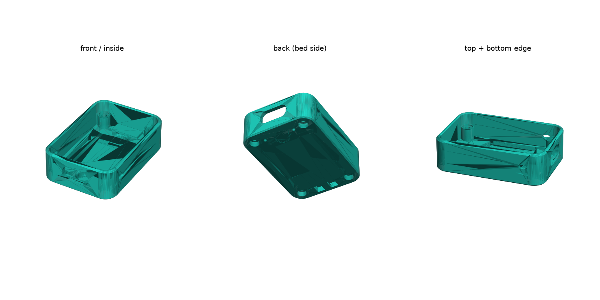

# Doobie Companion: back case

A 3D-printed back case for the **Waveshare ESP32-S3-Touch-AMOLED-1.64** (V1). The board screws into the case from behind. Two SOLDR-spec magnets let it snap onto wearables, SOLDR plates or anything steel, and there's a discreet keychain bar in the back.

## Files
| File | What |
|---|---|
| `case.py` | Parametric CadQuery source. All dimensions are at the top. |
| `case.step` | Solid for CAD. |
| `case.stl` / `case.3mf` | Print files. The 3MF opens in Bambu Studio. |
| `board_dummy.step` | Simplified board (glass, PCB, back parts, battery) used for the interference check. |

Rebuild: `~/snrgy-ereader-cad/.venv/bin/python case.py`. This prints the dimensions and a case-vs-board interference check, which currently shows 0 mm³ for every part.

## Key dimensions
- **Outer size:** 32.72 × 47.60 × 14.00 mm. The glass stands 0.5 mm proud, so the total is 14.5 mm. Corners are R5.5, the top edge has a 0.8 chamfer and the back edge a 0.5 chamfer.
- **Walls:** 1.6 mm, with 0.2 mm clearance around the glass. Back plate 3.2 mm, battery floor 1.2 mm. Nothing is under 1.2 mm except the intended 0.3 mm magnet skins.
- **Stack from the bed:** battery pocket z 1.2 → 5.7, then 3.2 mm of space for the back-side parts. The PCB sits on the posts at z 8.9, and the glass front is at z 14.5.
- **Thinner version:** set `BAT_T = 0` / move the battery to get about 10 mm total if you run off USB only.

## BOM
| Qty | Part |
|---|---|
| 4 | **M2 × 8** screws, pan or socket head (ISO 7380 / ISO 14580 / DIN 912), stainless. Heads sit in Ø4.2 × 2.3 counterbores. The tip reaches 1.4 mm into the PCB threads and stops 0.2 mm short of the display. **Don't use longer than 8 mm.** |
| 2 | **Ø6 × 3 mm N52 disc magnets**, same as SOLDR. Keep the same pole facing out on both if you want it to mate with a SOLDR plate. |
| 1 | LiPo **402025** (4.0 × 20 × 25 mm, about 150–180 mAh) with a JST lead for the board's BAT connector. It lies 25 mm across. The pocket is 26 × 21 × 4.5. |
| opt. | Split ring Ø10–12 mm, or a lanyard cord ≤ 1.2 mm. |

## SOLDR magnet spec (measured from the SOLDR module print files)
- Ø6.5 pocket with 6 crush ribs down to Ø6.1, so the magnet press-fits with no glue.
- 2.9 mm deep, closed by a **0.3 mm skin on the outside**. Magnets press in **from the inside** before the board goes in, and are invisible from outside.
- 0.65 mm lead-in chamfer at the pocket mouth.
- **Pitch 30 mm** along the long axis at (0, +13.5) and (0, −16.5). That's SOLDR's 30 mm grid, so it also snaps onto SOLDR plates.
- **Why 30 mm and not 18 mm:** an 18 mm pair across the short axis would sit over the battery. 30 mm fits the magnets above and below the battery with 1.25 mm walls, and keeps the magnets far apart for anti-rotation.

## Keychain
A flush 10 × 4 mm slot at the top centre of the back, with a 3 × 4 × 1.2 mm bar across it. A 1.4 mm channel runs under the bar. Thread a lanyard in one side and out the other, or hook a split ring around the bar. It prints on the bed, and the channel ceiling is a 4 mm bridge, so it needs no supports.

## Cut-outs
- **USB-C:** 12 × 6.4 mm, R2.5, centred on the receptacle at z 7.3.
- **RST (left) / BOOT (right):** 3.6 × 1.8 mm slots for pressing with a pin.
- **PWR / CHG LEDs:** two Ø1.4 holes through the back. Faint glow only.

## Print (Bambu P1P)
- **Orientation:** **back face on the bed**, as exported. No supports.
- **Material:** PETG (tougher, better for the keychain) or PLA. 0.2 mm layers, first layer 0.2.
- **Walls and infill:** 3 walls, 25% gyroid.
- **Magnet skin:** at 0.2 mm layers the 0.3 mm skin comes out about 2 layers (0.4). That's fine, the pull barely changes.
- **Counterbores:** the step from Ø4.2 to Ø2.3 is a small bridge. Enable "thick bridges" if it sags.

## Assembly
1. Press both magnets into their pockets from the inside, until flush with the floor.
2. Lay the LiPo in its pocket. Route the lead to the BAT JST and plug it in.
3. Drop the board in, glass up. The PCB rests on the four posts.
4. Fit 4 × M2×8 from the back. Snug, don't crank.

## Estimated, worth checking on the real board
- **Back-side part height:** assumed ≤ 3.2 mm (USB-C is the tallest). Change `COMP_CLEAR` if anything rubs.
- **RST/BOOT position:** y = −15.3 mm, z = PCB back − 1.0, read off the drawing. The slots are 3.6 mm long to absorb error.
- **LED positions:** read off the drawing at (±6.7, −18.6).
- **PCB corner radius:** assumed R3.0. With sharp corners the PCB would touch the cavity corners.
- **The M2 threads:** treated as flush pads, with a 0.6 mm relief recess on each post. If your board has protruding SMT nuts, raise `POST_RECESS_H` to the nut height.
- **Pin headers:** must be **unsoldered**. If you solder them, set `HEADER_CLEARANCE` to about 4 mm.
